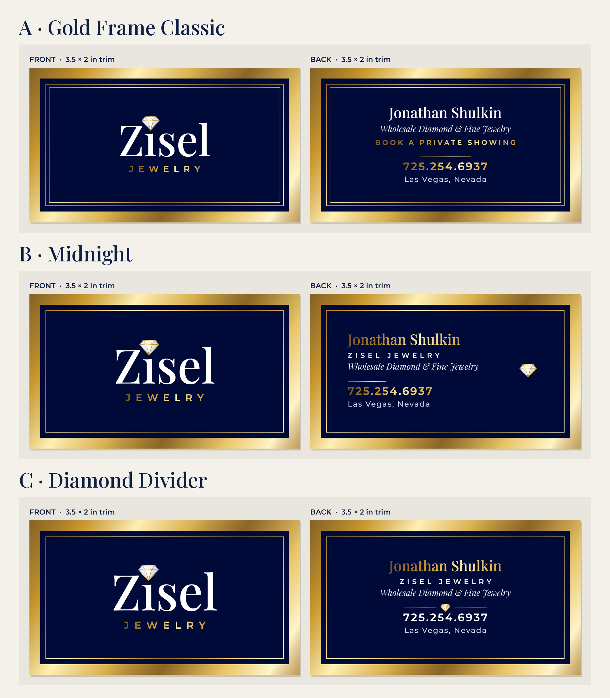

# Zisel Jewelry · Print business cards (3 concepts), rev 3

**Revised:** Monday Oct 19, 2026, ~8:30 PM PDT (rev 2: navy on both sides, metallic gold shimmer, gold border band like the poster). **Rev 3, ~9:35 PM PDT:** concept A back only (see below); B and C unchanged. For Jonathan Shulkin (owner). **Status:** concepts for Jonathan Yu to choose from, not sent.

**Front:** Zisel logo only. It's built the same way as the approved logo: Playfair "Zısel", the white diamond with metallic-gold edges, and metallic-gold "JEWELRY".
**Back (B, C):** Jonathan Shulkin / ZISEL JEWELRY / Wholesale Diamond & Fine Jewelry / 725.254.6937 / Las Vegas, Nevada.
**Back (A, rev 3):** Jonathan Shulkin / Wholesale Diamond & Fine Jewelry / BOOK A PRIVATE SHOWING / gold rule / 725.254.6937 / Las Vegas, Nevada.
**Not on the card:** website, email, street address, job title.

**All concepts, both sides:** navy panel, plus a wide metallic-gold band along the card edge (0.14 in visible inside trim, running out through the full 0.125 in bleed) with a thin gold hairline inset 5 pt inside it. This follows the invite poster.

## Concepts

| | Front | Back |
|---|---|---|
| **A · Gold Frame Classic** | Logo centered; band + hairline + a second fine inner frame (double rule) | **Rev 3:** centered: white name, italic tagline, **BOOK A PRIVATE SHOWING** (6.3 pt Montserrat SemiBold caps, tracked, gold shimmer; the headline of the client's favourite poster), plain gold divider, gold phone. ZISEL JEWELRY removed (it repeats the front logo). The block is optically centered inside the frame (17.0 / 17.1 pt above/below). Same double frame. |
| **B · Midnight** | Logo centered (slightly larger); band + hairline | Left-aligned: gold name and phone, white ZISEL JEWELRY, short gold divider, small diamond accent at right |
| **C · Diamond Divider** | Largest logo; band + hairline, no inner frame | Centered: gold name, white ZISEL JEWELRY, gold rule–diamond–rule divider, white phone |

Preview: 

## Files

| File | What |
|---|---|
| `zisel-business-card-{A,B,C}_print-bleed_CMYK.pdf` | **Print-ready**, 2 pages (front, back), 3.75 × 2.25 in incl. 0.125 in bleed, no marks. TrimBox/BleedBox set. |
| `zisel-business-card-{A,B,C}_print-crop-marks_CMYK.pdf` | Same, on a 4.25 × 2.75 in sheet with crop marks outside the bleed. |
| `rgb/…_RGB.pdf` | Same artwork in DeviceRGB (screen / digital proofing). |
| `zisel-business-card-{A,B,C}_preview.png` | Front and back side by side at trim size, rendered from the CMYK PDF at 600 dpi (Ghostscript). |
| `zisel-business-card-concepts.png` | All 3 concepts (copy at `/workspace/zisel/business-card-concepts.png`). A-only rev 3 preview: `/workspace/zisel/business-card-A-rev3.png`. |
| `src/concepts.py` | **Edit here:** text, inks, gradient stops, band/hairline sizes, per-concept options. |
| `src/build.py` | Rebuilds everything: `cd src && python3 build.py` (needs reportlab, uharfbuzz, fonttools, shapely, Pillow, ghostscript). |
| `src/fonts/` | Static instances of the brand fonts (Playfair Display 400/500 + Italic 400, Montserrat 500/600; SIL OFL). |
| `src/gem.svg` | Logo diamond (copied from `invite/gem.svg`; its polygons and gradient are reproduced in `build.py`). |

## Print specs

- **Size:** trim 3.5 × 2 in (US), bleed 0.125 in on each side, safe zone 0.125 in inside trim.
- **Placement (checked at 600 dpi):** all text and logos sit ≥ 25 pt inside the safe line and ≥ 17 pt clear of the inner frame line. The gold band is 10 pt visible inside trim, so a slightly off-center cut stays even.
- **Vector:** 100% vector, with no raster images. **Text is outlined** (HarfBuzz-shaped with kerning, then converted to paths), so the PDFs contain no fonts at all.
- **Gold shimmer:** this is the brand metallic gradient from `invite/zisel.css` (`#7a5a14 → #c99a3a → #fff1b8 → #d8b35a → #8f6b1e → #e8c870 → #fff5cc → #a97d25`). It's written as native PDF axial shadings in DeviceCMYK, so it prints as a smooth gradient. At 600 dpi the largest step between neighbouring pixels in the band is 2/255, with no banding. The diamond edges use the gem.svg gradient (`#7a5a14 → #fff1b8 → #b8892c → #f3dc8f`).
- **Type sizes:** name 13.5 pt Playfair, tagline 8 pt Playfair Italic, "ZISEL JEWELRY" (B, C) 6.5 pt Montserrat SemiBold tracked, slogan (A) 6.3 pt Montserrat SemiBold tracked caps, **phone 10 pt** Montserrat SemiBold, location 7 pt Montserrat Medium, logo "JEWELRY" ≈ 8–9 pt.
- **Color:**
  - Gold and light inks were converted sRGB → CMYK with Ghostscript's "Artifex CMYK SWOP" profile, not the printer's own profile.
  - Navy is hand-set to **C100 M70 Y5 K80**. The straight profile conversion of #0d1f45 gave a muddy C89 M78 Y48 K73 at 288% ink.
  - Ask the printer for a hard or soft proof, especially for the navy.
- **Foil option:** if the printer offers it, the gold areas can be sent for **gold foil** (band, hairlines, gold type, dividers, diamond edges). Real foil looks metallic, which a CMYK gradient can only imitate. Ask the printer how they want the foil separation (usually a 100% K spot layer named "Foil" matching the gold shapes); we can produce that from `build.py`.
